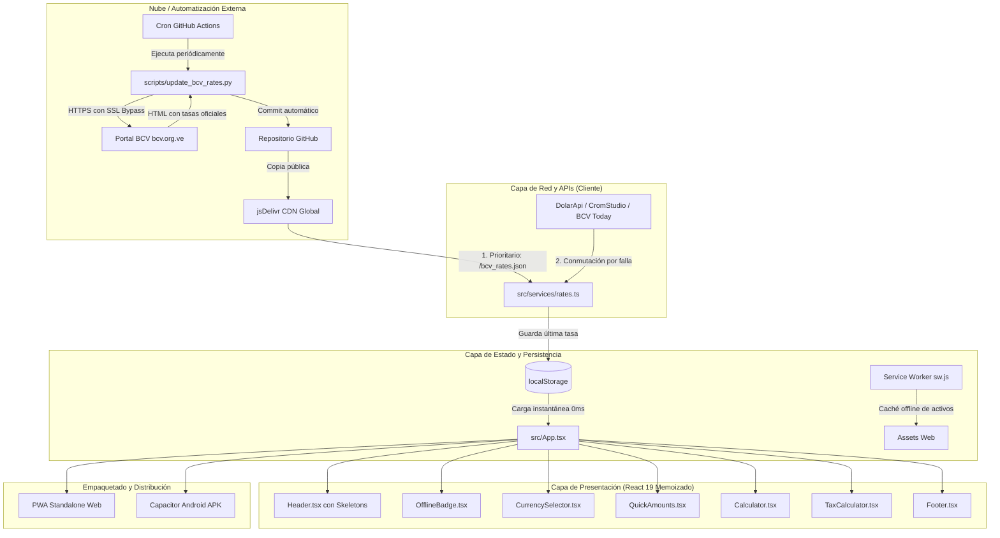

# ARQUITECTURA DEL SISTEMA Y DISEÑO TÉCNICO

> **Proyecto:** Calculadora Tasas BCV  
> **Stack:** React 19 + TypeScript + Vite 8 + TailwindCSS 4 + Capacitor 8 + GitHub Actions  
> **Autor:** Renato Andara (RA 2026)  

---

## 1. Diagrama de Arquitectura Global

---

## 2. Capas de la Aplicación

### 2.1 Capa de Presentación (UI)
- **Componentes Atómicos y Desacoplados:**
  - `Header`: Renderizado de tarjetas de tasas USD y EUR con estados esqueleto (`animate-pulse`) cuando no hay valores previos, y disparador de refresco en vivo.
  - `CurrencySelector`: Conmutación entre divisas y botón de inversión de sentido (`⇄`).
  - `QuickAmounts`: Botones con montos frecuentes de uso cotidiano.
  - `Calculator`: Campo de entrada numérico optimizado para teclado móvil decimal, display de gran formato del resultado y botón de copiado.
  - `TaxCalculator`: Controles independientes para inclusión de IVA e IGTF.
  - `OfflineBadge`: Indicador visual de modo offline/online y antigüedad del dato.
  - `Footer`: Firma requerida del autor (*Desarrollado por RA 2026*).

### 2.2 Capa de Servicios y Estado
- **`src/services/rates.ts`**:
  - Contiene el motor de peticiones con `fetchWithTimeout` y `AbortController`.
  - Implementa la **deduplicación de peticiones activas** para compartir promesas en llamadas simultáneas.
  - Orquesta el orden de conmutación en cascada.
- **`src/services/storage.ts`**:
  - Gestiona la serialización y lectura de las preferencias del usuario y la última tasa de cambio conocida.
- **`src/utils/formatters.ts`**:
  - Formatea números en estándar venezolano (coma como separador decimal y punto para millares), así como tiempos relativos (*"hace 5 min"*).

### 2.3 Capa de Despliegue y Distribución
- **PWA (Progressive Web App):** Service Worker en `public/sw.js` con estrategia *stale-while-revalidate* para activos estáticos y precarga de `bcv_rates.json`.
- **Nativo (Android):** Puente de Capacitor configurado en `capacitor.config.ts` y proyecto Gradle en `android/`.

---

## 3. Optimizaciones de Rendimiento Implementadas

En cumplimiento con la guía de rendimiento (31 recomendaciones de optimización), se aplicaron mejoras medibles:

### 3.1 Prevención de Re-renderizados Innecesarios (Recomendación #26)
- **Problema previo:** En React, cuando el usuario tecleaba un dígito en el campo de entrada (`inputAmount`), el componente padre `App` provocaba el re-renderizado de toda la vista (Header, CurrencySelector, QuickAmounts, etc.).
- **Solución:**
  - Se envolvieron todos los componentes satélites con `React.memo()`.
  - Se envolvieron las funciones controladoras (`handleSelectCurrency`, `handleToggleDirection`, etc.) con `useCallback()`.
  - **Impacto:** Ahora, al escribir en el teclado numérico en un celular, **únicamente el componente `Calculator` se re-evalúa**, logrando 60 FPS estables sin tirones en dispositivos de gama baja.

### 3.2 Deduplicación de Llamadas de Red (Recomendación #3)
- **Problema previo:** Si el evento `online` se disparaba al mismo tiempo que la carga de montaje o un clic manual, se lanzaban múltiples peticiones concurrentes a las APIs externas.
- **Solución:** Se implementó una variable en módulo `activeFetchPromise` en `rates.ts`. Si ya existe una solicitud en curso, las subsiguientes llamadas esperan la misma promesa en lugar de abrir nuevas conexiones TCP/TLS.

### 3.3 Skeletons de Carga (Recomendación #1)
- Se añadieron marcadores de posición animados en `Header.tsx` mediante Tailwind (`animate-pulse bg-slate-700/60 rounded h-6 w-24`).
- **Impacto:** Evita el cambio acumulativo de diseño (*Cumulative Layout Shift* - CLS = 0) al iniciar la aplicación antes de recibir los datos.

### 3.4 División de Código y Vendor Chunks (Recomendación #22)
- En `vite.config.ts`, se configuró `manualChunks`:
  - `vendor`: React y React-DOM (~65 KB gzip) separados en un chunk independiente que se almacena permanentemente en la caché del navegador.
  - `icons`: Lucide React (~5 KB gzip).
  - `index`: Lógica de la aplicación reducida a solo **24 KB**.

### 3.5 Eliminación de Código Muerto y Activos Inútiles (Recomendación #11)
- Se eliminaron del bundle activos heredados de la plantilla inicial (`src/App.css`, `hero.png`, `react.svg`, `vite.svg`), reduciendo el tamaño total del paquete web y del APK de Android.
